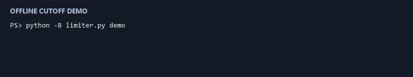

# Claude Code Usage Limiter

Stop Claude Code at a configurable subscription usage cutoff and save allowance for Claude chat. The Windows launcher starts enabled at 90% and enforces the cutoff across the monitored five-hour and weekly limits. [Claude usage limits](https://support.claude.com/en/articles/11647753-how-do-usage-and-length-limits-work)



Try the same demo with `python -B limiter.py demo`. It uses a temporary database and a disposable Windows process tree, with no Claude requests.

## Set up Claude Code

Use Windows, PowerShell, Python 3.10 or later, and a current native Claude Code executable on your PATH. Download the ZIP from [GitHub Releases](https://github.com/DannyHelou/claude-code-usage-limiter/releases). Compare the result of `Get-FileHash -Algorithm SHA256 -LiteralPath <zip-path>` with the hash in the release notes. After it matches, run `Unblock-File -LiteralPath <zip-path>` before extracting so PowerShell can load the downloaded scripts under its RemoteSigned policy. If you already extracted the ZIP and PowerShell blocks the script, unblock the verified ZIP and extract it into a new folder. Then run this in the extracted folder.

```powershell
.\install-powershell.ps1
```

Open a new PowerShell terminal and type `claude` as usual. Before the first coding prompt, enter the current usage readings from **Claude → Settings → Usage** as described below. The installer adds a function to your user profile for the PowerShell edition you ran it in. The installed program stays under `%LOCALAPPDATA%\ClaudeCodeUsageLimiter\versions` after you move the download. To start a guarded session from the extracted folder without installing the function, use `python limiter.py launch`.

In the Claude Code prompt, enter `/limiter`. Then enter one of these choices.

- `/limiter enable` opens the cutoff step. Enter `/limiter 90`, or substitute your own percentage.
- `/limiter disable` switches the guard off and closes the settings.

Enter `/limiter cancel` to leave without changes. The command and its replies are handled locally before any model request. Claude Code displays the local reply under its hook message. Changes apply immediately and persist across launches. Existing installations keep their saved cutoff. [Claude Code prompt hooks](https://code.claude.com/docs/en/hooks#userpromptsubmit)

For initial or stale usage readings, get the values from **Claude → Settings → Usage** and open the readings window from the extracted folder.

```powershell
$store = "$env:LOCALAPPDATA\ClaudeCodeUsageLimiter\data"
python limiter.py --store $store window
```

Enter the percentage used without a percent sign. Enter the reset as Unix seconds or as a date and time with a timezone, such as `2026-11-25T18:30:00-05:00`. Use your actual reset time. For a subscription with just one window, run `python limiter.py --store $store configure --windows five_hour` or use `seven_day`. Omit `--store $store` when using the standalone launcher from this folder.

The installed command works from any project and passes CLI arguments through, such as `claude --continue`. For the standalone launcher, put Claude flags after `--`, as in `python limiter.py launch -- --continue`.

## Upgrade or uninstall

Run the new release's `install-powershell.ps1` to upgrade. The installer keeps the usage database and can migrate a prior checkout-based registration. Close guarded sessions before uninstalling, then run `.\uninstall-powershell.ps1` from the extracted release and reopen PowerShell. Uninstall removes the managed profile block and installed program versions, leaving saved usage and preferences under `%LOCALAPPDATA%\ClaudeCodeUsageLimiter\data`. To delete those too, remove that `data` folder after uninstalling.

The limiter stores usage percentages, reset times, preferences, and temporary settings-menu state locally. It uses Claude Code's status-line data and the readings you enter. The limiter does not read Claude credentials or send telemetry.

## How the cutoff works

- Interactive Claude Code sessions send their reported five-hour and weekly usage to the guard through the status line. A new or higher reading refreshes the local sample. Running `record` refreshes it directly. If a required sample is missing, older than 15 minutes, or past its reset, the guard pauses coding until it has a current reading. Set a different interval with `configure --max-age MINUTES`. [Claude Code status line](https://code.claude.com/docs/en/statusline)
- On Windows the launcher checks for a crossed cutoff every 200 ms. When it sees one, it forcibly closes that Claude Code session and its local child processes, including during an active turn. This can interrupt a tool command partway through. If you lower the cutoff below an already reported reading, the same stop applies immediately. The hook also blocks new prompts and stops the tool loop at supported checkpoints. [Claude Code hooks](https://code.claude.com/docs/en/hooks)
- Claude reports usage with model responses. A response can spend past the cutoff before the new reading arrives, and stopping the local process cannot undo usage already charged. Chat activity elsewhere can also change the balance between updates. Leave some margin below the allowance you want to preserve. [Claude Code status line](https://code.claude.com/docs/en/statusline)
- The status line feeds the two general subscription windows during interactive sessions. Additional model-specific quotas and clients launched without these settings are outside this integration. For headless sessions, refresh readings separately. Use a separate `--store PATH` for each subscription account. A distinct store keeps its settings and readings together.

For hook-only operation, run `claude --settings <path-to-claude-settings.json> --add-dir <path-to-claude-integration>` using the settings path printed by `configure` and the `claude-integration` directory in this project. This mode blocks at supported hook checkpoints and uses the same cutoff settings. The separate process-tree stop is available through the Windows launcher.

## Use the guard with another CLI

If another provider publishes the percentage used and reset time for a shared limit, use a separate store, configure the window names you track, and feed its readings with `record`. Run `check` before starting the coding CLI. A launcher can treat exit code 2 as a stop signal. Mid-session enforcement requires a hook in that CLI that checks the same store before dispatching more work. Claude Code is the built-in integration.

```powershell
python limiter.py --store .usage-limiter/other configure 70 --windows weekly
python limiter.py --store .usage-limiter/other record weekly (Read-Host 'Weekly percent used') (Read-Host 'Weekly reset time')
python limiter.py --store .usage-limiter/other check
```

Run the local tests with `python -B -m unittest -v`.
